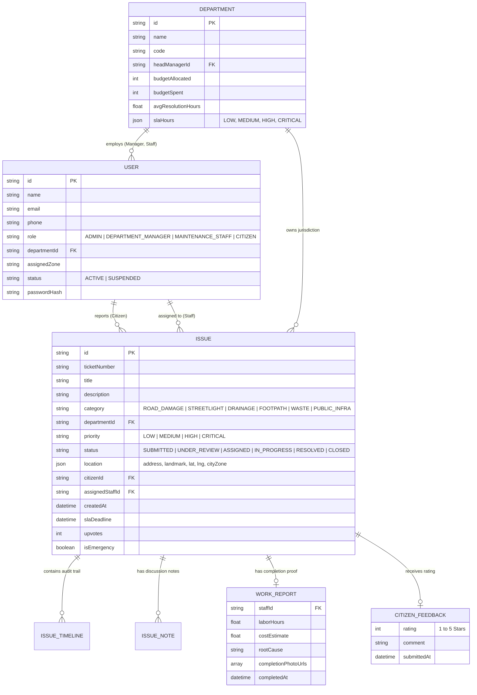

# CivicPulse — Advanced Smart City Infrastructure Management Platform
**Project Category:** GovTech • **Difficulty Level:** Hard • **Architecture:** Next.js 14 (App Router) • **Language:** TypeScript

**CivicPulse** is an enterprise-grade Smart City Infrastructure Management Platform designed to connect Citizens, Municipal Departments, Maintenance Field Crews, and City Administrators through a transparent, automated, and GIS-enabled issue resolution workflow.

---

## 📋 Executive Overview & Features

CivicPulse delivers an end-to-end civic operations operating system:
1. **Citizens** lodge public infrastructure damage with GPS coordinates, photos, and descriptions.
2. **Department Managers** verify incoming reports, calibrate priorities, merge duplicates, and dispatch tasks to specialized field crews.
3. **Field Maintenance Staff** receive work orders, inspect site locations on interactive vector GIS maps, track SLA countdowns, and upload certified before/after completion proof.
4. **City Administrators** maintain complete oversight with Recharts executive analytics, department leaderboards, system configurations, and user IAM controls.

---

## 🏛️ System Architecture & App Router Structure

```
src/
├── app/
│   ├── layout.tsx                    # Root layout with ToastProvider & CivicPulseProvider
│   ├── globals.css                   # Tailwind styles, print styles (@media print), GovTech animations
│   ├── page.tsx                      # Landing Page & Dynamic Role Workspace Router
│   ├── auth/
│   │   ├── login/page.tsx            # Login page with 1-click evaluator demo presets
│   │   └── register/page.tsx         # Citizen registration with password complexity meter
│   ├── citizen/page.tsx              # Dedicated Citizen Workspace
│   ├── my-reports/page.tsx           # Citizen 5-stage progress tracking & feedback review
│   ├── department/page.tsx           # Department Manager Triage Queue & Review
│   ├── team/page.tsx                 # Field Maintenance Staff & Workload Balancing
│   ├── admin/page.tsx                # Admin Console & System Governance
│   ├── analytics/page.tsx            # Executive Analytics, Heatmap & CSAT Dashboard
│   ├── users/page.tsx                # Identity & Access Management (IAM) directory
│   ├── profile/page.tsx              # User Profile & Security Credential Settings
│   ├── issues/
│   │   ├── page.tsx                  # All Issues Directory (Search, Filters, Server Pagination)
│   │   ├── new/page.tsx              # 3-Step Wizard with Automatic Duplicate Detection
│   │   └── [id]/page.tsx             # Issue Details Page with Printable PDF Dossier
│   └── api/
│       ├── auth/route.ts             # Server-side authentication endpoint
│       ├── issues/route.ts           # REST endpoint for querying, filtering, and creating issues
│       └── issues/[id]/route.ts      # Server-side RBAC validation and status transitions
├── components/
│   ├── dashboards/
│   │   ├── AdminDashboard.tsx        # System control, KPIs, departments & system config
│   │   ├── ManagerDashboard.tsx      # Triage queue, staff workload balancing, review actions
│   │   ├── StaffDashboard.tsx        # Maintenance patrol orders & completion reports
│   │   └── CitizenDashboard.tsx      # Community feed, report tracking & feedback
│   ├── AdvancedFilterBar.tsx         # Debounced search, category/priority/date range filters
│   ├── AnalyticsDashboard.tsx        # Recharts Monthly AreaChart, Category PieChart, BarChart
│   ├── DepartmentRankingLeaderboard.tsx # Leaderboard ranking departments by SLA and CSAT
│   ├── ImageUploader.tsx             # Drag-and-drop file uploader with validation
│   ├── InteractiveMap.tsx            # Vector GIS map with GPS locator & Heatmap visualization
│   ├── IssueDetailModal.tsx          # Before/after slider, immutable timeline, PDF export
│   ├── Navbar.tsx                    # Header with live telemetry stream, dark mode toggle, toasts
│   ├── NewIssueModal.tsx             # Modal wizard for reporting issues
│   ├── RoleSwitcherModal.tsx         # Instant 1-click persona switcher
│   ├── ToastNotification.tsx         # Global floating alerts (Success, Info, Warning, Critical)
│   └── UserProfileModal.tsx          # Profile & password security modal
├── context/
│   └── CivicPulseContext.tsx         # Central state engine, LocalStorage sync, RBAC & dispatch
├── data/
│   ├── sampleLocations.ts            # 32 municipal locations across all city sectors
│   ├── maintenanceStaff.ts           # 24 certified field technicians across all 6 departments
│   ├── generateSeedIssues.ts         # Deterministic generator producing 108 rich issues
│   └── seedData.ts                   # Initial departments, users, and system config
├── lib/
│   ├── security.ts                   # Section 5 security rules (GPS validation, sanitization, RBAC)
│   └── utils.ts                      # Haversine distance, SLA tracker, date formatters, badges
└── types/
    └── index.ts                      # TypeScript domain models and contracts
```

---

## 🗄️ Database Design & Entity Relationships

The platform implements relational schema models supporting all domain entities:



---

## 🏆 Bonus Challenges Implementation

| # | Bonus Challenge | Implementation Details |
|---|----------------|------------------------|
| **1** | **Real-Time Issue Notifications** | Simulated live telemetry incident stream toggle (`Radio` icon in Navbar). Generates real-time municipal alerts every 35s, fires floating toast popups, increments notification badges, and provides an instant "Simulate Live Alert" trigger. |
| **2** | **Automatic Duplicate Issue Detection** | Real-time Haversine distance scanner evaluates coordinates against active issues within 300m in `NewIssueModal` and `/issues/new`. Displays match % similarity and provides a 1-click **"Upvote Existing Ticket"** button to eliminate duplicate submissions. |
| **3** | **Heatmap-Based Issue Visualization** | Dedicated **Heatmap Mode** toggle (`Flame` icon) in `InteractiveMap.tsx`. Uses CSS radial thermal gradients (Cyan $\rightarrow$ Amber $\rightarrow$ Crimson Red) to visualize high-incident density clusters across city sectors. |
| **4** | **Department Performance Ranking** | Dynamic **Leaderboard component** (`DepartmentRankingLeaderboard.tsx`) ranking all 6 departments by a composite score factoring SLA compliance rate, resolution velocity, and verified citizen CSAT. Displays Gold 🏆, Silver, and Bronze badges. |
| **5** | **Citizen Satisfaction Analytics (CSAT)** | Integrated into `AnalyticsDashboard.tsx`. Calculates average rating (e.g. 4.8 / 5.0), approval percentage (94%), 5-star distribution breakdown, and displays recent verified citizen testimonials. |
| **6** | **Automated Maintenance Reminders** | SLA countdown timers highlight tickets approaching deadline (<4h or overdue). Managers can click **"Send SLA Reminder"** to push an automated notification and audit note to the assigned technician. |
| **7** | **PDF Issue Reports** | **"Export PDF"** button in `IssueDetailModal.tsx` and dedicated route `/issues/[id]`. Custom `@media print` layout generates an official Municipal Incident Dossier with City Seal, QR code verification, before/after photos, timeline transcript, and sign-off blocks. |
| **8** | **Dark Mode** | Complete Dark Mode implementation via Tailwind `dark:` classes with a Sun/Moon toggle in the Navbar, persisted in `localStorage`. |

---

## 📊 Minimum Data Requirements Checklist

- [x] **Minimum 4 User Roles**: Admin, Department Manager, Maintenance Staff, Citizen.
- [x] **Minimum 5 Departments**: 6 Municipal Departments active (`Road Damage`, `Streetlight`, `Drainage`, `Footpath`, `Waste Management`, `Public Infrastructure`).
- [x] **Minimum 100 Issues**: **108 fully populated issues** generated with realistic descriptions, coordinates, timelines, before/after photos, work reports, and feedback.
- [x] **Minimum 20 Maintenance Staff**: **24 certified field technicians** distributed across all 6 departments with distinct specialties, active task loads, and phone numbers.
- [x] **Minimum 30 Sample Locations**: **32 real-world municipal locations** mapped to 8 city sectors with verified GPS coordinates and landmarks.

---

## 🌐 Complete Expected Pages Directory

| Route | Page Name | Primary Capability |
|-------|-----------|--------------------|
| `/` | **Landing & Workspace** | Public City Portal showcase with live telemetry counter, before/after slider, and dynamic role workspace router. |
| `/auth/login` | **Login Page** | User sign-in with 1-click evaluator demo presets for all 4 roles. |
| `/auth/register` | **Citizen Registration** | Registration wizard with real-time password strength meter. |
| `/citizen` | **Citizen Dashboard** | Citizen workspace for tracking personal reports and community upvoting. |
| `/issues/new` | **Create Issue Wizard** | 3-step wizard with category picker, vector GIS pin, and automatic duplicate detection. |
| `/my-reports` | **My Reports** | Citizen report tracking with 5-stage progress bar and feedback rating. |
| `/issues` | **Issue Management** | All Issues directory with debounced search, filters, and server-side pagination. |
| `/issues/[id]` | **Issue Details** | Dedicated inspection view with printable official PDF dossier layout. |
| `/department` | **Department Dashboard**| Manager queue with triage, priority calibration, and staff dispatch. |
| `/team` | **Team Management** | Maintenance roster with workload capacity meters and dispatching. |
| `/admin` | **Admin Dashboard** | System-wide executive control, department setup, and global config. |
| `/analytics` | **Analytics Dashboard** | Recharts Area/Pie/Bar charts, Department Leaderboard, and CSAT metrics. |
| `/users` | **User Management** | Identity & Access Management (IAM) directory with role filters and status toggles. |
| `/profile` | **Profile Settings** | Profile editing, password change, and RBAC permission inspector. |

---

## 🔑 Demo Credentials for All Four Roles

Use the **Switch Role** button in the header or the credentials below on `/auth/login`:

| Role | Name | Email | Password | Primary Jurisdiction |
|------|------|-------|----------|----------------------|
| **Admin** | Eleanor Vance | `admin@civicpulse.gov` | `admin123` | Citywide Central Command |
| **Department Manager** | Marcus Brody | `manager.roads@civicpulse.gov` | `manager123` | Road Damage & Pavements |
| **Department Manager** | Sarah Chen | `manager.light@civicpulse.gov` | `manager123` | Streetlight & Electrical Grid |
| **Maintenance Staff** | Liam Gallagher | `staff.liam@civicpulse.gov` | `staff123` | Asphalt Repair & Paving |
| **Maintenance Staff** | Maya Patel | `staff.maya@civicpulse.gov` | `staff123` | High Voltage Systems |
| **Citizen** | Sophia Al-Mansoor | `sophia.citizen@gmail.com` | `citizen123` | Sector 4 - Downtown |
| **Citizen** | David Kim | `david.kim@outlook.com` | `citizen123` | Sector 2 - East Meadow |

---

## 📡 REST API Documentation

### 1. `GET /api/issues`
Query all issues with debounced search, filtering, and server-side pagination.
- **Parameters:**
  - `search`: string (searches title, description, address, reporter)
  - `departmentId`: string (or `ALL`)
  - `category`: string (or `ALL`)
  - `priority`: `LOW | MEDIUM | HIGH | CRITICAL`
  - `status`: `SUBMITTED | UNDER_REVIEW | ASSIGNED | IN_PROGRESS | RESOLVED | CLOSED`
  - `page`: integer (default: 1)
  - `limit`: integer (default: 10)
  - `sortBy`: `createdAt | priority | status | updatedAt`
  - `sortOrder`: `asc | desc`
- **Response:**
  ```json
  {
    "data": [ ...issues ],
    "pagination": {
      "page": 1,
      "limit": 10,
      "total": 108,
      "totalPages": 11,
      "hasNextPage": true,
      "hasPrevPage": false
    }
  }
  ```

### 2. `POST /api/issues`
Submit a new infrastructure issue with server-side validation.
- **Payload:** `{ title, description, category, departmentId, location, photoUrls, user }`
- **Validations:** Title $\ge 5$ chars, Description $\ge 15$ chars, Latitude $[-90, 90]$, Longitude $[-180, 180]$.

### 3. `GET /api/issues/[id]`
Retrieve complete ticket history, work report, citizen feedback, and immutable timeline.

### 4. `PATCH /api/issues/[id]`
Enforces Section 5 RBAC status transitions and jurisdiction rules on the server.

---

## 💻 Tech Stack & Dependencies

- **Framework:** Next.js 14.2.35 (App Router, Server Components + Client Workspaces)
- **Frontend:** React 18
- **Language:** TypeScript (Strict type checks)
- **Styling:** Tailwind CSS (with `dark:` variants & `@media print` rules)
- **Data Visualization:** Recharts (`AreaChart`, `PieChart`, `BarChart`, `ResponsiveContainer`)
- **Icons:** Lucide React
- **Utilities:** `clsx`, `tailwind-merge`

---

## 🚀 Installation & Local Execution

```bash
# 1. Install dependencies
npm install

# 2. Run local development server
npm run dev

# 3. Open in browser
http://localhost:3000

# 4. Run production build verification
npm run build
npm run start
```
